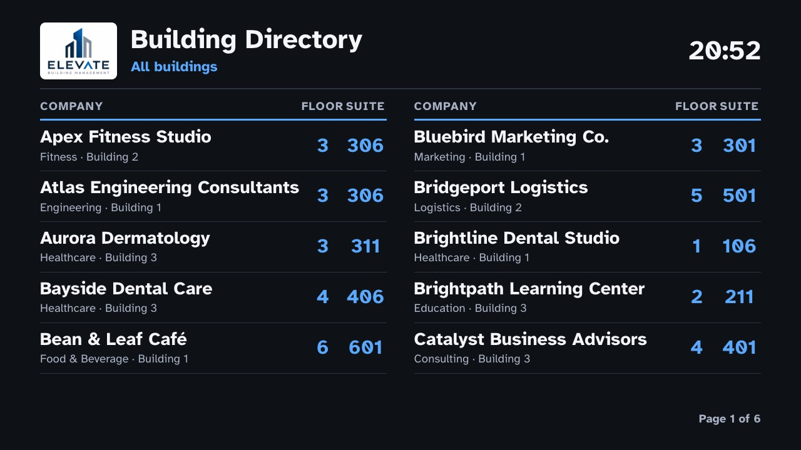
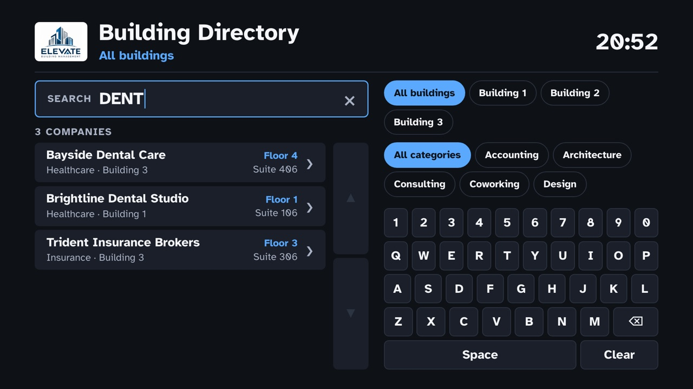
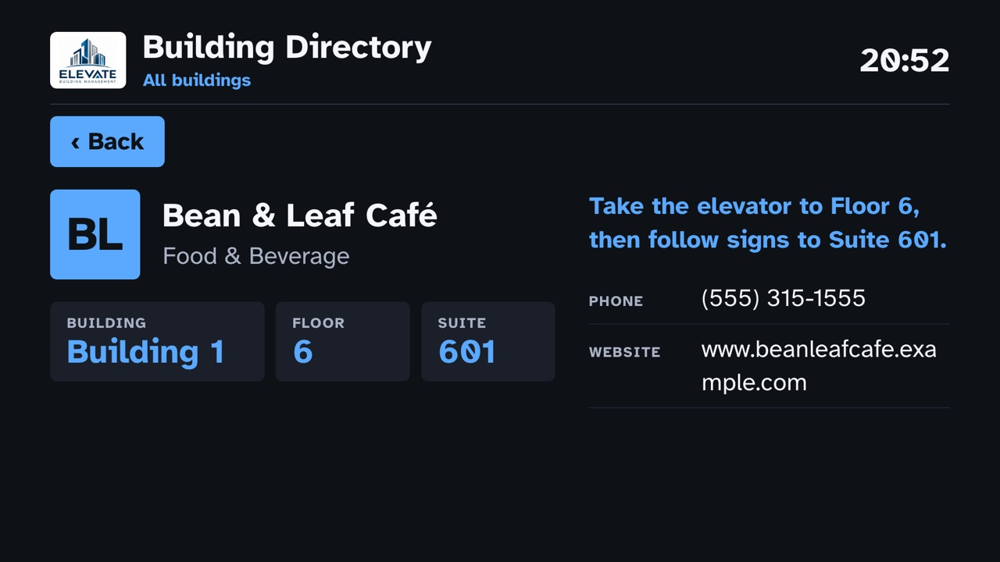
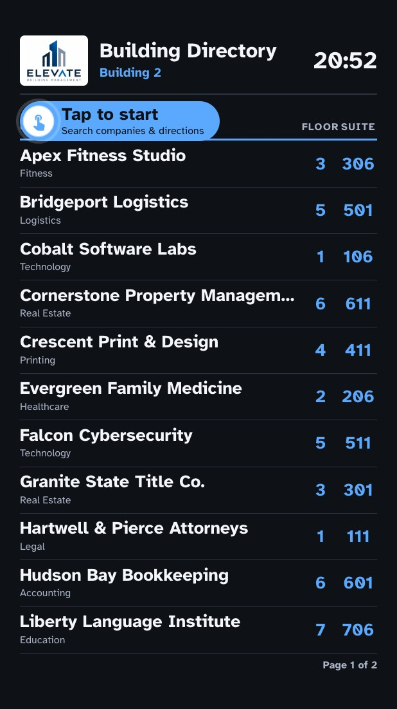

# Building Directory for EasySignage

A ready-to-use **building directory** (tenant list) for **digital signage
screens** running [EasySignage](https://easysignage.com). It works on both
**non-touch** and **touch** screens. Upload one file, then choose per screen
**which buildings to list** and **whether the screen is a touchscreen** by
adding simple tags to the screen. No coding needed.

| Screen type | What it shows |
|---|---|
| **Non-touch screen** (lobby display, wall screen, TV) | The company list pages through by itself, A–Z with floor and suite. No interaction needed. |
| **Touchscreen** (kiosk, interactive display), tagged `touchscreen` | The same paging list with a **Tap to start** badge. A tap opens search with an on-screen keyboard, filters and company details, and it returns to the list when nobody is using it. |

It runs fully offline on the screen, works in landscape and portrait, and
follows the EasySignage
[custom app guidelines](https://github.com/easysignage/Digital-Signage-Custom-Apps).

> **Built with AI.** This app was built by an AI coding agent from the
> [prompt at the end of this page](#build-it-with-an-ai-agent). You can use the
> same prompt to rebuild or adapt it.



| Touchscreen: search | Touchscreen: company details |
|---|---|
|  |  |

---

## Contents

**For screen owners**

- [Features](#features)
- [Quick start](#quick-start)
- [Screen tags](#screen-tags)
- [The touchscreen experience](#the-touchscreen-experience)
- [Customising](#customising)
- [Troubleshooting](#troubleshooting)

**For developers**

- [Project structure](#project-structure)
- [Build and package](#build-and-package)
- [Preview in a browser](#preview-in-a-browser)
- [How it works](#how-it-works)
- [Test checklist](#test-checklist)
- [Build it with an AI agent](#build-it-with-an-ai-agent)

---

## Features

- **One file for every screen.** Each screen shows its own building(s) based
  on its tags.
- **Any number of buildings.** Show one building, several, or all of them.
- **Display screens** page through the list automatically
  ("Page 2 of 4"), sorted A–Z, with floor and suite for every company.
- **Touchscreens** show a **Tap to start** prompt. A tap opens search with a
  built-in on-screen keyboard, building and category filters, and a details
  page for each company with directions, phone and website. The screen
  resets itself after a minute of no use.
- **Landscape and portrait**, detected automatically.
- **Readable from a distance**: high-contrast signage theme, large text,
  dark, light and high-contrast colour options.
- **Works offline.** Everything is stored on the screen.
- **Your branding**: your logo, a title and an accent colour.

---

## Quick start

**1. Download the app**

Download [building-directory.zip](https://github.com/easysignage/Digital-Signage-Building-Directory-Using-AI/raw/main/downloads/building-directory.zip).
It contains sample data: three buildings with 20 made-up companies each, and a
sample logo. See [Customising](#customising) to use your own.

**2. Upload it to EasySignage**

1. Go to **Media** and upload `building-directory.zip`.
2. Add it to a **playlist**.
3. Assign the playlist to your screens and click **Publish changes**.

**3. Tag your screens**

Open each screen, click **More → Tags**, add the tags below, press Enter after
each one, then click **Save**.

| This screen should show | Add these tags |
|---|---|
| Only Building 1 | `building1` |
| Buildings 1 and 3 | `building1` and `building3` |
| All buildings | `all` (or no building tag) |
| Building 2 on a touchscreen | `building2` and `touchscreen` |

Then click **Publish changes** on the playlist so the screens pick up their
tags. If a screen shows all buildings when it shouldn't, see
[Troubleshooting](#troubleshooting).

---

## Screen tags

Tags are typed on each screen in EasySignage (**More → Tags**). Capital
letters don't matter.

### Which buildings to show

| Tag | Effect |
|---|---|
| `building1`, `building2`, … | Show that building. Add one tag per building. |
| `all` | Show every building. |
| *(no building tag)* | Show every building. |

The building names come from the sheet names in the listings spreadsheet
(see [Your company listings](#your-company-listings)). If you add a sheet
called `building4`, the tag `building4` shows it.

When a screen shows more than one building, each company also shows its
building name.

### Touchscreen

| Tag | Effect |
|---|---|
| `touchscreen` (or `touch`) | Turns on Tap to start, search and company details. |

Screens **without** this tag ignore taps completely.

### Optional settings

These tags use the `name:value` form, for example `title:Welcome to Elevate`.

| Tag | Example | Default | Effect |
|---|---|---|---|
| `title` | `title:Tenant Directory` | Building Directory | Heading at the top |
| `theme` | `theme:light` | `dark` | Colours: `dark`, `light` or `contrast` (high contrast) |
| `accent` | `accent:#0057b8` | blue | Highlight colour, as a hex colour |
| `page_seconds` | `page_seconds:15` | `10` | Seconds each page shows (5–60) |
| `idle_seconds` | `idle_seconds:90` | `60` | Touchscreens: seconds of no use before going back to Tap to start (15–600) |

> Building tags also work in the `name:value` form, for example
> `building:building2` or `building2:yes`.

---

## The touchscreen experience



1. **Tap to start.** While nobody is using it, the screen pages through the
   list like a display screen. A **Tap to start** badge with a hand icon
   floats at the top-left of the list.
2. **Search.** A tap anywhere opens search. Visitors type on the built-in
   keyboard, and the list filters as they type, by company name or category.
   They can also tap building and category filters, and scroll the list by
   swiping or with the ▲ ▼ buttons.
3. **Company details.** Tapping a company shows its building, floor and suite,
   a "Take the elevator to Floor …" direction, and the phone, website, email
   and opening hours if you provide them.
4. **Reset.** After 60 seconds of no use (change it with `idle_seconds`), the
   screen clears the search and goes back to Tap to start.

The opening tap only opens search; it never presses a key or a company by
accident.

<br clear="right" />

---

## Customising

### Your company listings

Listings live in [`companies.xlsx`](companies.xlsx).

- **One sheet per building.** The sheet name is the building's tag:
  `building1`, `building2`, `building3`. To add a building, add a sheet
  (for example `building4`). It is shown as "Building 4".
- **Row 1 holds the column headings.** Then one row per company:

| Column | Required | Example | Shown |
|---|---|---|---|
| Company Name | yes | Harborview Capital Partners | List, search, details |
| Floor | yes | 1 | List, details |
| Suite | yes | 101 | List, details |
| Category | yes | Finance | List, category filter, details |
| Phone | no | (555) 300-1000 | Details |
| Website | no | www.example.com | Details (as text) |
| Email | no | info@example.com | Details |
| Hours | no | Mon–Fri 9am–5pm | Details |
| Description | no | One or two sentences | Details |
| Logo | no | `harborview.png` | Details (file in `app/images/logos/`) |

Empty rows and extra columns are ignored.

After editing the spreadsheet, rebuild the zip (see
[Build and package](#build-and-package)) and upload the new zip in place of
the old one in EasySignage, then publish the playlist. If you are not
comfortable running the build, ask whoever maintains your signage, or use the
[AI agent prompt](#build-it-with-an-ai-agent).

### Your logo

> **The Elevate Building Management logo is a sample logo** for demonstration
> only. It does not belong to a real company.

Replace [`app/images/building-logo.png`](app/images/building-logo.png) with
your own logo, keeping the same file name, then rebuild the zip. Use a PNG
about 720 px wide on a white or transparent background. The logo sits on a
white card so it stays readable on every colour theme.

### Title, colours and timing

Use the [optional settings tags](#optional-settings). No rebuild needed.

---

## Troubleshooting

When a screen finds no building tag, it shows **all buildings** and, for the
first 5 minutes, a small **yellow line** at the bottom, for example:

```
No building tag found, showing all buildings. Tags received: none · Screen: Lobby · Data from: player object (URL has data)
```

Use it to see what the screen actually received.

| What you see | Likely cause | What to do |
|---|---|---|
| All buildings, yellow line says **Tags received: none** | The tags have not reached the screen. | Check the tags are saved on that screen (**More → Tags → Save**), then **Publish changes** on the playlist and let the screen update. |
| All buildings, yellow line **lists tags** | The building tag doesn't match a sheet name. | Check the spelling. `building2` must match a sheet called `building2`. |
| Yellow line says **Screen: unknown** | The screen isn't receiving any player data. | Contact EasySignage support. The [player-info](https://github.com/easysignage/Digital-Signage-Custom-Apps/raw/main/downloads/player-info.zip) app shows what a screen receives. |
| No **Tap to start** on a touchscreen | The `touchscreen` tag is missing or hasn't reached the screen. | Add `touchscreen` and check the yellow line as above. |
| Black screen, no logo or title | The screen isn't running the app. | Play the EasySignage [clock](https://github.com/easysignage/Digital-Signage-Custom-Apps/raw/main/downloads/clock.zip) example on the same screen. If it's also black, contact EasySignage support. |
| Yellow text starting with **Error:** | A script error on that player. | Send a photo of the message to whoever maintains your signage. |
| Old content after an update | The screen still has the previous zip. | Replace the media item with the new zip and **Publish changes**. |
| Clock shows the wrong time | The screen's own clock or timezone is wrong. | Fix the time settings on the screen. |

---

## Project structure

```
.
├── README.md
├── companies.xlsx            ← listings: one sheet per building
├── downloads/
│   └── building-directory.zip  ← ready-to-upload app (rebuilt by package.sh)
├── docs/images/              ← screenshots for this README
├── scripts/
│   ├── build-data.py         ← companies.xlsx → app/data.js
│   ├── check.sh              ← EasySignage checks (ES5, paths, secrets), from the SDK
│   └── package.sh            ← build data, run checks, zip app/
└── app/                      ← the custom app (its contents are the zip)
    ├── index.html            ← entry point
    ├── errors.js             ← shows script errors on screen
    ├── easysignage.js        ← reads player data (EasySignage SDK, unchanged)
    ├── theme.css, theme.js   ← signage theme (EasySignage SDK)
    ├── fonts/                ← Atkinson Hyperlegible + licence
    ├── data.js               ← GENERATED from companies.xlsx
    ├── common.js             ← shared helpers
    ├── tags.js               ← tags → buildings / touchscreen
    ├── directory.js          ← paging list (display screens, Tap to start)
    ├── touch.js              ← search, keyboard, filters, details, idle reset
    ├── app.js                ← start-up: reads the screen, picks the mode
    ├── style.css
    └── images/
        ├── building-logo.png ← SAMPLE logo, replace with yours
        └── logos/            ← optional company logos
```

---

## Build and package

Requires Python 3 and `openpyxl`:

```bash
pip3 install openpyxl
```

Then, from the repository root:

```bash
./scripts/package.sh
```

This converts `companies.xlsx` into `app/data.js`, checks the app against the
EasySignage rules, and writes `dist/building-directory.zip` with `index.html`
at the root. It also copies the zip to `downloads/building-directory.zip`.
Commit that file so the download link in [Quick start](#quick-start) serves
the new version.

---

## Preview in a browser

Serve the `app` folder:

```bash
cd app && python3 -m http.server 8000
```

Then open a preview link. Test tags go in the address as `tags.<name>=<value>`:

| Scenario | Link |
|---|---|
| Building 1, landscape | `http://localhost:8000/?resolution=1920x1080&tags.building1=` |
| All buildings | `http://localhost:8000/?resolution=1920x1080&tags.all=all` |
| Buildings 1 and 3, portrait | `http://localhost:8000/?resolution=1080x1920&tags.building1=&tags.building3=` |
| Touchscreen, Building 2 | `http://localhost:8000/?resolution=1080x1920&tags.building2=&tags.touchscreen=` |
| Touchscreen, light theme | `http://localhost:8000/?tags.all=all,touchscreen&tags.theme=light` |
| No tags (yellow line) | `http://localhost:8000/` |

Resize the window to check landscape and portrait. Click to tap; your
computer keyboard also types into the search.

---

## How it works

- **Data.** Players can't read files at runtime, so `scripts/build-data.py`
  turns `companies.xlsx` into `app/data.js` (`window.APP_DATA`), loaded with a
  plain `<script>` tag.
- **Tags.** The app reads tags from both places EasySignage sends them: the
  injected player object (`EasySignage.read()`) and the page address. It
  accepts any form: plain labels (`building2`), `name:value` pairs, the
  combined `tags.all` string, lists and JSON. Every tag name and value
  becomes a lowercase word. A building is shown when a word equals its sheet
  name; `all` or `all-buildings` shows every building; `touchscreen` or
  `touch` turns on touch mode.
- **Orientation** comes from the real screen size, not the reported
  resolution, because portrait-mounted screens often report a landscape
  resolution. The layout is redone if the window size changes after loading.
- **Display mode** measures how many rows fit and pages through them with a
  slow fade, reusing the same elements, so it can run for days.
- **Touch mode** builds its screen once and switches between the paging list
  (with Tap to start) and the search screen. The idle timer returns to the
  paging list.
- **Errors.** `errors.js` loads first and prints any script error on screen,
  since players have no console.

### Technical rules

The app follows the EasySignage custom app
[best practices](https://github.com/easysignage/Digital-Signage-Custom-Apps/blob/main/docs/best-practices.md):

- `index.html` at the root of the zip; every file bundled; relative paths only.
- ES5 JavaScript with classic `<script src>` tags, for older Tizen, webOS and
  BrightSign players.
- Flexbox only: no CSS grid, `clamp()` or flex `gap`.
- No `fetch()` of local files.
- No API keys, tokens or passwords: the zip is copied to every screen.
- Text from tags and data is inserted as plain text (`textContent`).

---

## Test checklist

- [ ] `building1` shows only Building 1; two building tags show both; `all` shows all
- [ ] No tags or an unknown tag shows all buildings plus the yellow line
- [ ] A new `building4` sheet shows with the `building4` tag after rebuilding, with no code change
- [ ] Display screens page with "Page X of Y"; no paging when everything fits
- [ ] `touchscreen` shows Tap to start; a tap opens search; screens without it ignore taps
- [ ] Search, keyboard, filters, details and Back work; idle returns to Tap to start
- [ ] Landscape (1920×1080) and portrait (1080×1920) look right, nothing cut off
- [ ] A portrait screen reporting `resolution=1920x1080` still gets the portrait layout
- [ ] `./scripts/package.sh` reports 0 errors; the zip has `index.html` at the root

---

## Build it with an AI agent

This app was built with the prompt below. Use it with Claude Code, Codex,
Cursor, GitHub Copilot or another coding agent, run in a copy of this
repository. For best results, first install the EasySignage custom app skill
(Claude Code):

```
/plugin marketplace add easysignage/Digital-Signage-Custom-Apps
/plugin install easysignage-custom-apps@easysignage
```

Copy the prompt:

```text
Build an EasySignage custom app: an offline building directory for digital
signage screens. Follow the EasySignage custom app rules and starter from
https://github.com/easysignage/Digital-Signage-Custom-Apps (use the
easysignage-custom-app skill if installed; otherwise read its
skills/easysignage-custom-app/SKILL.md, references/, docs/best-practices.md
and templates/starter/). Copy easysignage.js, theme.css, theme.js and fonts/
from that repo's sdk/ folder unchanged. This repository's README.md describes
the finished app; follow it.

HARD RULES
- App lives in app/; index.html at the zip root; all assets bundled; relative paths only.
- ES5 only (var, function(){}; no arrow functions, let/const, template literals,
  classes, async/await, ?. or ??). Plain <script src>, never type="module".
- No CSS grid, clamp() or flex gap. Flexbox + CSS variables.
- No fetch()/XHR of local files: data ships as app/data.js (window.APP_DATA).
- No secrets, no remote URLs, no CDNs. Render data and tag strings with textContent.
- Signage theme: --text-* sizes, nothing below --text-xs, 5% safe area, dark
  default, contrast >= 4.5:1, slow motion only, support `theme` and `accent` tags.
- Works in landscape and portrait, and with no tags at all.

DATA
- Source: companies.xlsx at the repo root. One sheet per building; the sheet
  name (building1, building2, ...) is the building ID; display name
  "building1" -> "Building 1". Row 1 headers: Company Name, Floor, Suite,
  Category, Phone, Website; optional Email, Hours, Description, Logo (file in
  app/images/logos/). Skip blank rows, ignore unknown columns, strings only.
- scripts/build-data.py (Python 3 + openpyxl) writes app/data.js:
  window.APP_DATA = { generated, buildings: [{ id, name, companies: [{ name,
  floor, suite, category, phone, website, email, hours, description, logo }] }] }.
- scripts/package.sh runs build-data.py, runs scripts/check.sh (from the
  SDK repo), zips the contents of app/ to dist/building-directory.zip and
  copies it to downloads/building-directory.zip. dist/ is git-ignored.

TAGS
- Read tags from EasySignage.read().tags AND from
  EasySignage.parseQuery(location.search).tags (and any other player field
  whose name contains "tag"). Accept any shape: object keys and values,
  "a,b" and "key:value" strings (tags.all), arrays of strings or of
  {key/name, value} objects, and JSON strings. Turn every tag name and value
  into lowercase trimmed words. Skip the key "all" itself.
- A building is shown when a word equals its id; "all" or "all-buildings"
  shows every building. If nothing matches, show all buildings and, for 5
  minutes, a small yellow line in the bottom safe margin (up to 2 lines):
  "No building tag found, showing all buildings. Tags received: <words or
  none> · Screen: <name or unknown> · Data from: <player object or URL>".
- Touch mode when a word equals "touchscreen" or "touch".
- Optional tags: title (default "Building Directory"), page_seconds (default
  10, 5-60), idle_seconds (default 60, 15-600), theme, accent.
- Keep tag parsing in app/tags.js as small pure functions.

LAYOUT
- Header: logo (app/images/building-logo.png, a sample logo, on a white
  rounded card, with alt text), title, building name(s) or "All buildings",
  clock HH:MM (format by hand, no Intl).
- Orientation from window.innerWidth/innerHeight (fall back to the
  resolution), because portrait-mounted screens may report 1920x1080. Re-lay
  out 2 s after load and whenever the window size changes (check once a
  second as well as on resize).
- app/errors.js loads first and shows uncaught errors as yellow text on screen.

DISPLAY MODE (every screen at rest)
- Companies A-Z; row = name, category (+ building when several), floor, suite.
- Measure rows per page from the available height; landscape uses two
  columns when there are more rows than fit in one; portrait one column.
  Auto-page every page_seconds with a slow fade and "Page X of Y". Reuse the
  row elements; one setInterval drives clock, paging and checks.

TOUCH MODE (only with the touchscreen/touch tag; otherwise taps do nothing)
- At rest the screen shows the display-mode list plus a flat "Tap to start"
  badge (accent pill, no shadow or gradient) floating at the top-left of the
  list, over the column labels only (move the list down slightly): a white
  circle with an inline SVG hand (slow press animation) and two slow ripple
  rings, then "Tap to start" and "Search companies & directions".
- A tap anywhere (document click listener) opens touch mode without pressing
  anything underneath. After idle_seconds without input it clears everything
  and returns to the at-rest list.
- Touch screen: search field (a display, not an input) with clear button;
  built-in keyboard (1-0, QWERTY rows, backspace, Space, Clear); filter as you
  type on name and category, ignoring case and punctuation; building chips
  (when several buildings) and category chips; "N companies"; empty state
  with a Clear button; list scrolls by swipe/drag and big up/down buttons.
  Landscape: search + list left, chips + keyboard right (44%). Portrait:
  search, chips, list, keyboard at the bottom. Tap targets >= 64px on 1080p.
- Details page: Back button; initials badge (or logo); name, category;
  Building / Floor / Suite boxes; "Take the elevator to Floor X, then follow
  signs to Suite Y."; phone, website (text only), email, hours, description
  when present. Landscape uses two columns (identity left, directions and
  contacts right).

VERIFY
- Run ./scripts/package.sh (0 errors).
- Serve app/ with python3 -m http.server and check, in 1920x1080 and
  1080x1920: ?tags.building1=  ?tags.all=all  ?tags.building1=&tags.building3=
  ?tags.building2=&tags.touchscreen=  and no query (yellow line). Also a
  1080x1920 window with ?resolution=1920x1080 (must lay out as portrait).
- Confirm buildings, paging, Tap to start, search, filters, details, Back,
  idle reset, no console errors and nothing cut off.
- Finish with the tags to set on each screen and the upload steps
  (Media -> upload zip -> add to playlist -> Publish changes).
```

---

## Links

- [EasySignage custom apps documentation](https://easysignage.com/help/custom-apps/digital-signage-custom-apps/)
- [EasySignage custom apps SDK, examples and AI skills](https://github.com/easysignage/Digital-Signage-Custom-Apps)
- [Uploading media to EasySignage](https://easysignage.com/help/apps/digital-signage-upload-media/)

All company names, phone numbers and websites in the sample data are made up.
